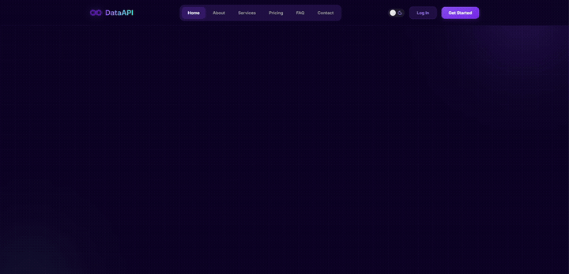

# ⚡ DataAPI — Web Data Extraction Platform (Frontend Demo)

<div align="center">
  <p align="center">
    <b>An interactive frontend demo showcase for an intelligent web data extraction API platform.</b><br>
    Engineered with Next.js 16, React 19, Framer Motion, Lenis smooth scrolling, and Tailwind CSS v4.
  </p>

  <p align="center">
    <a href="https://dataapilive1.netlify.app/" target="_blank"></a>
    &nbsp;
    <a href="https://github.com/Akshayjg2204/dataapilive"></a>
  </p>

  <p align="center">
    
    
    
    
    
    
  </p>
</div>

---

## 🎥 Platform Walkthrough & Interaction Preview

<div align="center">
  <a href="https://dataapilive1.netlify.app/">
    
  </a>
  <p align="center">
    <sub><b>✨ Autoplaying preview of AutoEx interactive console, live API simulation, and smooth scroll dynamics.</b></sub><br>
    <b><a href="https://dataapilive1.netlify.app/">🚀 Launch Live Web App</a></b> &nbsp;•&nbsp; 
    <b><a href="./public/demo.mp4">📥 Download / Watch Full 60 FPS HD Video (MP4)</a></b>
  </p>
</div>

---

## ✨ Design & Engineering Highlights

- **🤖 AutoEx Technology Showcase:** Animated interactive demo console that simulates live API calls and streams structured JSON responses to the viewport in real time.
- **📊 Multi-Section Architecture:** Seven distinct page sections (`Hero`, `Comparison`, `Innovation`, `ModernDevelopers`, `SpecializedAPIs`, `ScalableExtraction`) each with independent AOS scroll-reveal animations.
- **🌊 Ultra-Smooth Inertial Scrolling:** Lenis smooth scroll engine integrated site-wide for buttery 60 FPS viewport dynamics.
- **💜 Custom Dark Design System:** Deep `#130a32` purple-space palette with CSS variable–driven theming, neon accent glows, and glassmorphism cards.
- **🧭 Intelligent Multi-Page Navigation:** Full Next.js App Router with dedicated pages for `/about`, `/services`, `/pricing`, `/faq`, `/contact`, `/login`, and `/signup` — each with unique layouts.
- **⚡ Performance-First Rendering:** AOS scroll-driven reveals with Framer Motion spring physics eliminate layout shift while maintaining smooth progressive disclosure.

---

## 🛠️ Tech Stack

| Technology | Purpose |
| :--- | :--- |
| **Next.js 16** | App Router, file-based routing, and server component architecture |
| **React 19** | Concurrent rendering and modern UI component state management |
| **TypeScript** | Strict type contracts across all components and page modules |
| **Framer Motion** | Spring physics animations, scroll-linked reveals, and entry transitions |
| **Lenis** | Physics-based smooth inertial scrolling engine |
| **AOS** | Scroll-triggered animation orchestration for section reveals |
| **Tailwind CSS v4** | Next-generation utility-first styling with custom CSS variable design tokens |
| **Lucide React** | Consistent vector iconography across all UI surfaces |

---

## 🚀 Getting Started Locally

### Prerequisites
- Node.js 18+ or 20+
- npm or pnpm

```bash
# 1. Clone the repository
git clone https://github.com/Akshayjg2204/dataapilive.git
cd dataapilive

# 2. Install dependencies
npm install

# 3. Start development server
npm run dev
```

Open [http://localhost:3000](http://localhost:3000) in your browser to view the application.

### Building for Production
```bash
npm run build
```

---

## 👨‍💻 Author

**Akshay Gaikwad**  
Founder & Lead Engineer at [Streamline.dev](https://github.com/Streamline-dev0)  
- 🌐 Portfolio: [stream-line.dev](https://stream-line.dev/)  
- 💼 LinkedIn: [linkedin.com/in/akshayjgaikwad](https://www.linkedin.com/in/akshayjgaikwad/)  
- 🐙 GitHub: [@Akshayjg2204](https://github.com/Akshayjg2204)  
